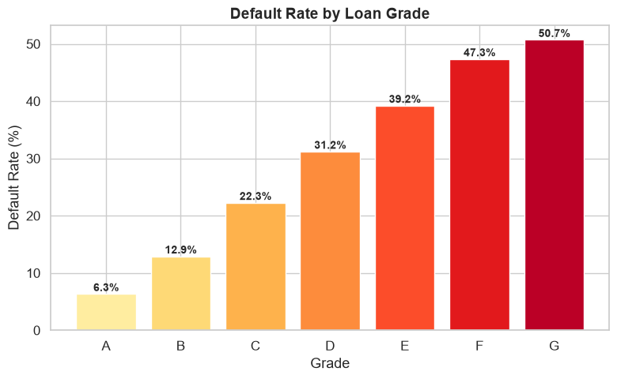
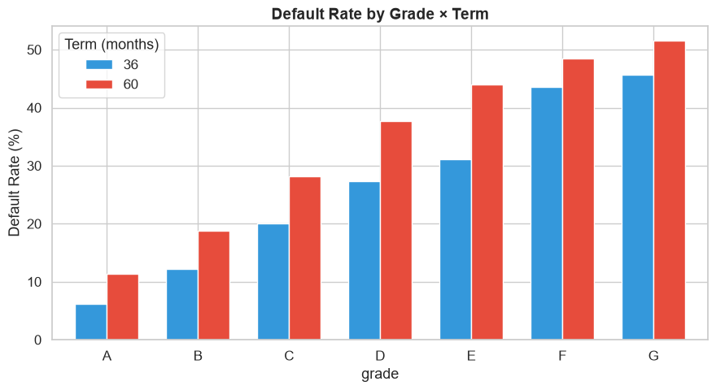
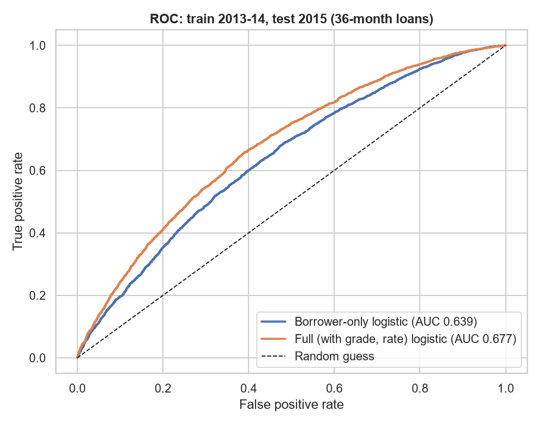
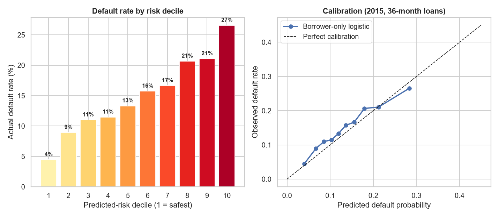
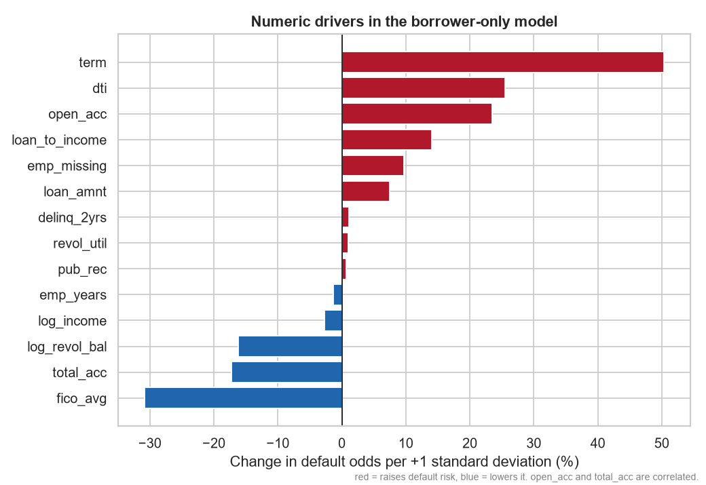

# 🏦 Lending Club Loan Default Risk Analysis

**Which borrower and loan traits predict default, and how should a lender adjust approval and pricing?**
EDA, hypothesis testing and a **baseline default-prediction model** on **69,981 closed Lending Club loans (2013–2016)** using Python, pandas, SciPy, statsmodels and scikit-learn.

🔗 **Live dashboard:** _add your Streamlit link here_  ·  📓 Notebooks in [`notebooks/`](notebooks)  ·  🤖 Model code in [`risk_model.py`](risk_model.py) and [`train_model.py`](train_model.py)

## At a glance

| Loans analysed | Default rate | Columns | Period |
|---|---|---|---|
| 69,981 | 20.2% (Charged Off) | 26 (after cleaning) | 2013–2016 |

## Key findings

- **Grade is the strongest signal.** Default climbs from **6.3% (A) to 50.7% (G)**.
- **60-month loans default more than 36-month** (33.9% vs 15.9% raw), but much of that gap is grade mix, because 60-month loans skew to weaker grades. Within the same grade it is about **1.1–1.8×** (grade-adjusted odds ratio ≈ 1.6).
- **Purpose matters, but weakly.** Among purposes with at least 300 loans, small business is the riskiest (29.4%) and car the safest (15.2%). Tiny categories (wedding n=49, renewable energy n=37) are too small to rank. Cramér's V is only 0.057.
- **Lower income and FICO go with default, but income barely.** Mean income $77.4K (paid) vs $70.6K (defaulted) is significant yet negligible in size (Cohen's d ≈ 0.09). FICO ↔ default r = −0.13; interest rate ↔ default r = 0.27.
- **Verification is not protective.** Verified borrowers default more (23.4%; source-verified 21.8%) than unverified (14.5%), likely because risky applicants get verified.

> **Read every default rate with one caveat.** The data ends in 2018Q4 and contains *closed loans only*, so still-running (mostly good) loans are missing. Default rates for 36-month loans issued in 2016 and 60-month loans issued after 2013 are overstated. See [Limitations](#limitations).




## Hypothesis tests (α = 0.05)

| # | Question | H₀ / H₁ | Test | Result |
|---|---|---|---|---|
| 1 | Do defaulters earn less/more? | **H₀:** mean income (Fully Paid) = mean income (Charged Off)<br>**H₁:** the means differ (two-tailed) | Two-sample t-test | t = 9.84, p ≈ 8e-23 → reject H₀. Effect is negligible (Cohen's d = 0.09) |
| 2 | Does default depend on purpose? | **H₀:** default and purpose are independent<br>**H₁:** they are associated | Chi-square + Cramér's V | χ² = 226.9, dof = 12, V = 0.057 → reject H₀ |
| 3 | Do interest rates differ by grade? | **H₀:** mean rate is equal across grades A-G<br>**H₁:** at least one grade differs | One-way ANOVA + Tukey | F = 130,166; every grade pair differs → reject H₀. Near-tautological: grade is assigned from the rate (η² = 0.92) |
| 4 | Do 60-month loans default more? | **H₀:** p₆₀ ≤ p₃₆<br>**H₁:** p₆₀ > p₃₆ (right-tailed) | Two-proportion z-test | z = 50.7, p ≈ 0 → reject H₀. Ignores grade; within-grade ratio 1.1–1.8×, Mantel-Haenszel OR = 1.60 |

> With ~70K rows, tiny differences become "significant". Read effect sizes (V, Cohen's d, rate gaps), not p-values alone. Test 1 uses uncapped income (max $8.7M), so Welch's t (7.15) and Mann-Whitney (p ≈ 2e-76) are shown as checks in the dashboard.

## Baseline default-prediction model

**Can borrower traits alone rank who will default, and does Lending Club's own grade add much?**

Logistic regression and gradient boosting (scikit-learn), each on two feature sets:

- **Borrower-only:** FICO, DTI, income, loan size, loan-to-income, term, purpose, home ownership, verification, credit history. *No grade, sub-grade, interest rate or installment.*
- **Full:** the above plus grade, interest rate and installment.

Installment is excluded from borrower-only on purpose: it is a function of loan amount, rate and term, so it would leak the interest rate back in.

Two validation schemes:

- **Random:** stratified 80/20 split over all loans (optimistic, same vintages in train and test).
- **Out-of-time on mature loans:** train on 36-month loans issued 2013-14, test on 36-month loans issued 2015. These are the only loans whose outcomes are all known by the end of the data. A test on 2016 loans would be distorted by unfinished loans (see Limitations).

| Model | AUC, random split | AUC, out-of-time (95% CI) | KS, out-of-time | Top-decile lift, out-of-time |
|---|---|---|---|---|
| Grade only (benchmark) | 0.688 | 0.664 (0.655-0.673) | 0.263 | 1.88× |
| Borrower-only, logistic | 0.699 | 0.639 (0.630-0.649) | 0.205 | 1.77× |
| Borrower-only, gradient boosting | 0.699 | 0.637 (0.627-0.647) | 0.205 | 1.79× |
| Full, logistic | 0.717 | 0.677 (0.667-0.686) | 0.267 | 2.05× |
| Full, gradient boosting | 0.716 | 0.671 (0.661-0.683) | 0.255 | 2.03× |





**What this shows**

- **Ranking power is modest** (AUC 0.64-0.72; 0.5 is a coin flip).
- **Lending Club's grade is a hard benchmark.** On the random split the borrower-only model appears to match it (0.699 vs 0.688), but only thanks to `term`, whose signal is inflated by unfinished loans: without `term` it drops to 0.671. On the clean out-of-time test the grade wins (0.664 vs 0.639; the intervals do not overlap).
- **Grade + rate + borrower traits ranks best** (0.677 out-of-time), a modest gain over grade alone.
- **Gradient boosting adds nothing** over logistic regression, so a transparent baseline is enough.
- **The model is well calibrated on finished loans.** Out-of-time, the safest decile defaults at 4.5% (predicted 4.0%) and the riskiest at 26.6% (predicted 28.4%), roughly 6× apart. Mean predicted vs actual default is within about 1 point for 2014 and 2015 test loans.
- **The apparent "under-prediction" on 2016 loans is mostly an artefact.** For 2016 loans the gap is 5.5 points, but their outcomes are incomplete (closed loans only), so defaults look too frequent. It should not be read as vintage drift.
- Strongest numeric signals (per +1 SD): higher FICO lowers default odds by ~31%; higher DTI raises them ~26%; longer term raises them ~50% (inflated by unfinished loans). `open_acc` and `total_acc` are correlated, so read them together.

Outputs live in [`models/`](models): `metrics.json` (incl. the calibration-by-year diagnostic), `deciles.csv`, `coefficients.csv`, `numeric_effects.csv`. Regenerate everything with `python train_model.py`.

## Recommendations

1. Apply stricter approval or pricing to **grades E–G** (39–51% default).
2. **Limit or price-up 60-month terms**, especially grades C–E, where the within-grade default rate is about 1.4× the 36-month rate. The raw ~2× gap overstates it.
3. Add extra checks (financials, collateral) for **small-business** loans.
4. Use **income, DTI and FICO** together; verification alone is not a safeguard, and income on its own is a weak signal.
5. **Score with grade plus borrower traits.** Grade is a strong benchmark; adding borrower traits and the rate gives the best ranking (AUC 0.68 out-of-time vs 0.66 for grade alone).
6. **Measure default on finished loans.** Only closed loans are in this data, so default rates for recent and 60-month loans are overstated. Re-estimate on cohorts old enough to have finished before setting prices.

## Method in brief

Chunked load of the 2.2M-row Kaggle file → keep Fully Paid / Charged Off, issued 2013–2016 → random sample of 70,000 (`random_state=42`) → clean (target flag, numeric term / emp_years, FICO average, income capped at 99th percentile, DTI 0–60) → EDA → 4 hypothesis tests → baseline models (random and out-of-time validation). Leakage columns (e.g. payments, recoveries) were never loaded.

## Run it

```bash
git clone https://github.com/MaulikSavaliya27/lending-club-default-risk.git
cd lending-club-default-risk
pip install -r requirements.txt
streamlit run app.py          # dashboard (includes the model tabs and risk scorer)
python train_model.py         # optional: re-train and refresh models/ and the model_*.png charts
```

The dashboard has seven tabs: default drivers, grade × term, credit signals, **hypothesis tests (recomputed live)**, **model performance with an approval-policy simulator**, an interactive **risk scorer**, and recommendations.

Re-running the notebooks needs `data/Raw/accepted_2007_to_2018Q4.csv` from [Kaggle](https://www.kaggle.com/datasets/wordsforthewise/lending-club) plus `pip install jupyter statsmodels`. Run `01_Load_and_Sample` then `02_EDA_and_Hypothesis_Tests`.

## Structure

```
app.py                  Streamlit dashboard (7 tabs, risk scorer, policy simulator)
risk_model.py           Feature definitions + model pipelines (shared by app and training)
train_model.py          Train, evaluate (random + out-of-time), write models/ and charts
notebooks/              01 load, sample, clean · 02 EDA + hypothesis tests
data/processed/         loans_clean.csv (analysis-ready)
models/                 metrics.json, deciles.csv, coefficients.csv, numeric_effects.csv
images/                 charts used in this README
```

## Limitations

- **Survivorship / right-censoring (the biggest caveat).** The data ends in 2018Q4 and keeps closed loans only, and the missing still-running loans are mostly good ones. Default rates for 36-month loans issued in 2016 and 60-month loans issued after 2013 are therefore overstated. This inflates the rise in default rate across vintages (15% for 2013 → 24% for 2016), the raw 60-month vs 36-month gap, and the `term` effect in the model. Only 36-month loans issued through 2015 and 60-month loans issued in 2013 have fully finished.
- **Associations, not causation.**
- **Grade and rate are Lending Club's own risk outputs**, so they summarise risk rather than explain it. That is why the borrower-only model is shown separately from the full model.
- **The model is a baseline.** AUC 0.64-0.72, no hyperparameter search, no geographic or macroeconomic features. Probabilities are well calibrated on finished 36-month loans, but the model is trained on closed loans only. It ranks risk; it is not a credit decision tool.
- **Accepted loans only.** Rejected applicants are not in the data, so the model cannot say how it would score them (reject inference).
- **Test 1 uses uncapped income**, as in the notebook, which makes the t-test sensitive to outliers (max income $8.7M). The conclusion holds under Welch's t-test and Mann-Whitney, and the effect is negligible (Cohen's d ≈ 0.09).
- **Test 3 is close to a tautology** (grade is assigned from the interest rate), and **Test 4 ignores grade** (60-month loans skew to weaker grades).

_Data: Lending Club via Kaggle. Educational project (Data Analytics mini project)._
